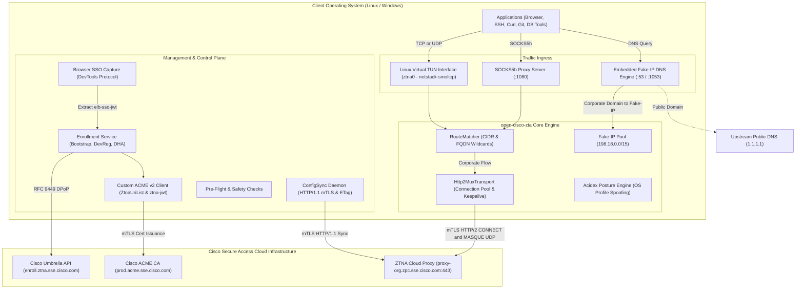

# System Architecture & Technical Principles

This document provides a comprehensive deep-dive into the internal architecture, component design, and protocol invariants of **open-cisco-zta**.

---

## 🏛️ High-Level System Overview

`open-cisco-zta` is structured into six modular subsystems:

1. **Control Plane (`src/control/`)**: Handles authentication, browser SSO cookie interception, device and DHA posture registration, dynamic policy synchronization, and safety pre-flight validations.
2. **Cryptographic Subsystem (`src/crypto/`)**: Implements RFC 9449 DPoP JWT proofs, RFC 8555 custom ACME v2 certificate issuance, and OpenSSL mTLS engine.
3. **Networking & DNS Engine (`src/net/`)**: Manages the Linux kernel TUN interface, userspace TCP/IP stack (`netstack-smoltcp`), synthetic Fake-IP pool (`198.18.0.0/15`), micro-DNS server, and `systemd-resolved` Split-DNS integration.
4. **Data Plane & Multiplexing (`src/dataplane/`)**: Establishes mTLS HTTP/2 transport to Cisco cloud proxies, multiplexing application TCP connections (`CONNECT`) and UDP datagrams (`CONNECT-UDP` MASQUE), as well as serving a local SOCKS5h proxy.
5. **Posture & Plugin System (`src/plugins/`)**: Synthesizes and injects device posture (`AcidexPayload`), allowing OS profile spoofing across all stages.
6. **Configuration & State Management (`src/config/`)**: Manages cross-platform persistent storage, real-user resolution under `sudo`, and serialized state schemas.



---

## 1. Control Plane (`src/control/`)

The control plane orchestrates authentication, posture reporting, certificate acquisition, and policy synchronization.

### 1.1 Enrollment Lifecycle (`enroll.rs`)

Enrollment initializes trust between the endpoint and the Cisco Secure Access tenant:

1. **Bootstrap Initialization (`bootstrap`):**
   - Connects to `https://enroll.ztna.sse.cisco.com/enrollInit`.
   - Sends a JSON payload specifying `choice_id: "cisco-secure-access/default"`.
   - Generates an ephemeral RFC 9449 DPoP key pair (EC P-256) and attaches a DPoP proof signed over the POST request.
   - Receives the SSO start URL (`sso-begin-url`), completion URL (`sso-end-url`), and DHA base URL.

2. **SSO Token Extraction (`parse_sso_jwt`):**
   - Captures the `elb-sso-jwt` cookie either automatically via DevTools Protocol or via manual user entry.
   - Decodes the JWT claims (such as `sub`, `user_id`, `origin_id`, `duo_device_id`, and `identifiers` map containing URN identities).

3. **Device Registration (`register_device`):**
   - Posts to the Cisco Umbrella device registration URL (`dev_reg_url`).
   - Generates a composite authorization header: `Authorization: DPOP <sso_jwt>, Bearer <sso_jwt>`.
   - Generates an RFC 9449 DPoP proof with ES256 that embeds both `ath` (SHA-256 hash of `sso_jwt`) and `body_hash` (SHA-256 hash of request body).
   - Obtains the Device Registration JWT (`dr_jwt`) and persistent `ztna_device_id`.

4. **DHA Posture Registration (`register_dha`):**
   - Posts to the DHA registration endpoint (`dha_reg_url`).
   - Sends the client posture (`AcidexDetail`) and ephemeral public key (`dha_enroll_pubkey`).
   - Attaches a composite header: `Authorization: DPOP <sso_jwt>, DPOP <dr_jwt>`.
   - Crafts a dual-proof DPoP header containing `elb_ath` (SHA-256 of `sso_jwt`), `dr_ath` (SHA-256 of `dr_jwt`), and `body_hash`.
   - Receives the final `DHA_ENROLL_DONE_JWT`, containing the authoritative ACME identity URIs.

5. **ACME Certificate Issuance:**
   - Issues a local P-256 key and generates a CSR containing the SAN URI attributes.
   - Completes the ACME challenge against Cisco's CA to retrieve the signed mTLS client certificate.

### 1.2 Automated Browser SSO Capture (`browser.rs`)

To eliminate copy-pasting cookies during enrollment:
- Discovers installed Chromium-based browsers across platforms:
  - **Windows:** Microsoft Edge, Google Chrome, Brave Browser from standard `ProgramFiles`, `ProgramFiles(x86)`, and `LOCALAPPDATA` paths.
  - **Linux:** Google Chrome, Chromium, Brave, Microsoft Edge via `PATH` and desktop launcher lookups.
- Spawns the browser with an isolated temporary user data directory (`--user-data-dir`) and a remote debugging port (`--remote-debugging-port=0`).
- Connects via WebSocket to the Chrome DevTools Protocol (CDP).
- Subscribes to `Network.responseReceived` and `Network.requestWillBeSent` events.
- Intercepts the `elb-sso-jwt` cookie as soon as the SSO identity provider redirects to `sso-end-url`.
- Automatically terminates the temporary browser instance once the token is acquired.

### 1.3 Dynamic Policy Synchronization (`sync.rs`)

The `ConfigSync` service keeps corporate routing rules up-to-date:
- Unlike the HTTP/2 data plane, `ConfigSync` communicates over **HTTP/1.1 mTLS** (`TlsConfig::for_http1`).
- Endpoint: `https://proxy-<org_id>.zpc.sse.cisco.com/.well-known/zta-config/cisco/v2`.
- Mandatory headers:
  - `x-zta-accept-config-schema-version: 2, 1`
  - `x-zta-enrollment-id: <ztna_device_id>`
  - `x-request-id: <UUIDv4>`
  - `If-None-Match: "<ETag>"` (when cached)
- Request Body: Serialized `AcidexPayload` JSON containing hardware and OS posture.
- Response handling:
  - `304 Not Modified`: Cached policy is still fresh; no parsing needed.
  - `200 OK`: Parses new `ZtnaConfigWrapper`, updates active `RouteMatcher`, and caches the new configuration and ETag to disk (`ztna_config.json`).

### 1.4 System Checks & Pre-Flight Validations (`system_check.rs`)

- **Root Enrollment Prevention (`check_enroll_privileges`):** Prevents running `enroll` as root/sudo on Linux to avoid launching GUI browsers in root context or saving config files with root ownership. Can be explicitly bypassed with `--allow-root`.
- **TUN Privilege Check (`check_run_privileges`):** Validates that full TUN mode runs with root/sudo or `CAP_NET_ADMIN` on Linux, or from an elevated shell on Windows, offering helpful instructions to run `sudo open-cisco-zta run` or switch to unprivileged `--proxy-only`.
- **Cisco Daemon Conflict Discovery (`check_conflicting_cisco_agents`):** Inspects the process table for active official Cisco Secure Client daemons (`csc_zta_agent`, `acsockd`, `vpnagentd`) to avoid interface and port collisions. Can be bypassed with `-f` / `--force`.

### 1.5 Non-Blocking Update Checker (`update_check.rs`)

- Asynchronously inspects the latest release on GitHub in the background without introducing latency to CLI startup.
- Uses GitHub redirect inspection (`/releases/latest`) to bypass strict GitHub API rate limits.
- Persists release status in a 24-hour cache file (`.update_cache.json`).
- Compares SemVer versions and prints an unobtrusive notification banner to `stderr` upon process completion.
- Can be suppressed via `OPEN_CISCO_ZTA_NO_UPDATE_CHECK=1` or `CI=1`.

---

## 2. Cryptographic Subsystem (`src/crypto/`)

### 2.1 RFC 9449 DPoP Implementation (`dpop.rs`)

Cisco Secure Access enforces strict RFC 9449 Demonstrating Proof-of-Possession at the Application Layer with non-standard extensions:
- **Key Algorithm:** ECDSA using curve P-256 and SHA-256 (`ES256`).
- **Header Type:** `typ: "dpop+jwt"` with the embedded public JWK in `jwk`.
- **URI Sanitization:** The `htu` (HTTP URI) claim must have all query strings and fragment identifiers stripped per RFC 9449.
- **Custom Access Token Hashes:**
  - Standard DPoP uses `ath: base64url(sha256(token))`.
  - Cisco Device Registration requires both `ath` and `body_hash: base64url(sha256(body))`.
  - Cisco DHA Registration requires `elb_ath: base64url(sha256(sso_jwt))`, `dr_ath: base64url(sha256(dr_jwt))`, and `body_hash`.

### 2.2 Custom ACME v2 Protocol Client (`acme.rs`)

Cisco uses an RFC 8555 ACME server with proprietary zero-trust extensions:
- **Order Identifier (`ZtnaUriList`):**
  - Identifier type: `"ZtnaUriList"`.
  - Value: Deterministically sorted (`BTreeMap`) SAN URI mapping (`urn:cisco:sse:orgid:...`, `urn:cisco:sse:userid:...`, `urn:cisco:sse:ztna:deviceid:...`) serialized to JSON and encoded as Base64URL without padding.
- **Custom Challenge (`ztna-jwt`):**
  - Authorizations provide challenges with `type == "ztna-jwt"`.
  - Responded with an empty JSON object `{}`.
  - Must include `Authorization: DPoP <dha_enroll_done_jwt>` and `Dpop: <proof>` headers.
- **CSR Structure:**
  - Common Name: `urn:cisco:sse:ztna:deviceid:<device_id>`.
  - Subject Alternative Names: Every entry from `san_map` encoded as X.509 `SanType::URI`.
- **Mandatory Transport Headers:**
  - Every ACME request must carry `x-request-id: <UUIDv4>` and `x-zta-enrollment-id: <device_id>`.

### 2.3 OpenSSL mTLS Connector (`mod.rs`)

- Manages TLS connector creation using `tokio-openssl`.
- Negotiates ALPN based on caller requirements:
  - Data Plane: ALPN `h2`.
  - ConfigSync: ALPN `http/1.1`.
- Automatically loads client certificate chains and P-256 private keys from the configuration directory.
- Inspects client certificates to verify expiration dates, issuer CAs, and Subject Alternative Names (`SAN URIs`).

---

## 3. Networking Subsystem (`src/net/`)

### 3.1 Embedded Fake-IP DNS Engine (`fakeip.rs`)

The Fake-IP engine allows transparent interception of corporate domain traffic without waiting for remote cloud DNS resolution:
- **Address Space:** `198.18.0.0/15` (benchmarking network reserved by RFC 2544 / RFC 5735, range `0xc6120001` through `0xc613fffe`).
- **Domain Matching:** Evaluates queries using `RouteMatcher`.
- **Resolution Strategy:**
  - **Corporate `A` record queries:** Instantly assigned a synthetic IPv4 from the Fake-IP pool with a short TTL (`5s`).
  - **Corporate Non-A queries (`AAAA`, `HTTPS` Type 65, `TXT`, `MX`):** Returned immediately with an empty `NOERROR` (NODATA) response. This is critical: forwarding corporate queries upstream causes timeouts and leaks corporate hostnames, while returning `NXDOMAIN` can break applications attempting subsequent `A` queries.
  - **Public domains:** Recursively forwarded to upstream public DNS resolvers (e.g. `1.1.1.1:53`).
- **EDNS0 Mirroring:** Request EDNS0 extensions are mirrored in DNS responses (`set_dnssec_ok(false)`) to ensure strict compatibility with `systemd-resolved`.
- **Dual Transport:** Embedded DNS listens simultaneously on UDP and TCP.

### 3.2 Linux Virtual TUN & Userspace Network Stack (`tun_device.rs`)

When running with full system privileges on Linux:
- Creates a virtual TUN device (`ztna0`, IP `100.64.0.1/32`, MTU 1500).
- Backed by `netstack-smoltcp`, an asynchronous userspace TCP/IP stack.
- Incoming packets on `ztna0` are processed in userspace:
  - DNS packets on port 53 are handled directly by the internal DNS engine.
  - TCP SYN packets establish userspace TCP streams. If the destination IP is in the Fake-IP pool, the original corporate FQDN is looked up and dialed over the HTTP/2 tunnel. If it matches a corporate CIDR, the IP:port is dialed directly.
  - UDP datagrams are dispatched to UDP tunnel streams using RFC 9298 MASQUE.

### 3.3 Linux Routing & Split-DNS Manager (`sys_route.rs`)

- **Kernel Routing (`ip route`):**
  - Routes the Fake-IP subnet `198.18.0.0/15` through `ztna0`.
  - Routes all policy-defined corporate CIDRs (e.g., `10.0.0.0/8`, `172.16.0.0/12`) through `ztna0`.
- **Firewall Integration:** Adds `ztna0` to the `firewalld` `trusted` zone if `firewalld` is active.
- **Split-DNS via `systemd-resolved`:**
  - Configures `resolvectl dns ztna0 127.0.0.1` (or `<tun_ip>`).
  - Prunes redundant subdomains (e.g., keeping `~example.com` while pruning `~sub.example.com`).
  - Configures routing domains `resolvectl domain ztna0 ~domain1 ~domain2`.
- **Signal Handling & Teardown:** Listens for `SIGINT` / `SIGTERM` to cleanly remove routes, reset `resolvectl` domains, and tear down the TUN interface before exiting.

---

## 4. Data Plane & Multiplexing (`src/dataplane/`)

### 4.1 HTTP/2 Multiplexed Transport (`mux.rs`)

All corporate traffic is multiplexed across an mTLS HTTP/2 connection to the assigned Cisco Secure Access proxy (`proxy-<org_id>.zpc.sse.cisco.com:443`):

- **Connection Management:** Maintains an active HTTP/2 connection pool with proactive 30-second keepalive PING frames to prevent cloud NAT timeouts.
- **Window Management & Flow Control:**
  - Initial connection window size: `4 MiB`.
  - Initial stream window size: `1 MiB`.
  - In `H2TunnelStream::poll_read`, `recv_stream.flow_control().release_capacity(len)` is called **immediately** as frames are consumed. This invariant ensures large downloads do not stall due to HTTP/2 window starvation.
- **TCP Tunneling (`CONNECT`):**
  - Uses standard HTTP/2 `CONNECT` method:
    - `:method = CONNECT`
    - `:authority = <destination_host>:<destination_port>`
- **UDP Tunneling (`CONNECT-UDP` / RFC 9298 MASQUE):**
  - Uses Extended `CONNECT` for UDP:
    - `:method = CONNECT`
    - `:protocol = CONNECT-UDP`
    - `:scheme = https`
    - `:authority = <proxy_host>`
    - `:path = /.well-known/masque/udp/<destination_host>/<destination_port>/`
  - Encapsulates datagrams in RFC 9297 `DATAGRAM` capsules:
    - Capsule Type = `0x00`
    - QUIC varint length = `1 + payload.len()`
    - Context ID = `0x00`
- **Flow Posture Injection:** Injects required `x-acidex-*` headers into every HTTP/2 stream request.

### 4.2 Local SOCKS5h Proxy Server (`socks5.rs`)

For unprivileged environments (Windows and non-root Linux):
- Runs a high-performance local SOCKS5h proxy server on `127.0.0.1:1080`.
- Supports RFC 1928 (SOCKS5) and RFC 1929 (no authentication required).
- Handles domain names (`ATYP 0x03`), IPv4 addresses (`ATYP 0x01`), and synthetic Fake-IPs.
- Evaluates destinations against `RouteMatcher`:
  - Matching corporate destinations are forwarded into the `Http2MuxTransport`.
  - Non-corporate destinations can be dialed directly or rejected depending on configuration.

### 4.3 Routing & Policy Matching Engine (`router.rs`)

The `RouteMatcher` performs deterministic routing checks:
- **CIDR Rules:** Uses an in-memory prefix tree of corporate subnets (`ipnet::IpNet`).
- **Domain Rules:** Matches FQDNs with support for wildcard prefixes (e.g., `*.corp.domain.com`).
- **Exclusion Rules:** Evaluates exclusion exceptions (such as `*.sse.cisco.com` or specific public subnets) to prevent routing loops.

---

## 5. Posture Spoofing Engine (`src/plugins/acidex.rs`)

Cisco cloud proxies inspect endpoint health and OS identity via proprietary `acidex` metadata.

### 5.1 Structure of `AcidexPayload`

The payload contains three core sections:
- `client`: Client application name, version, platform (`linux-x86_64` or `windows-x86_64`), and persistent `global_udid`.
- `os`: OS name (`Ubuntu 22.04.4 LTS` or `Windows 11 Pro`), version, kernel build, and architecture.
- `system`: Hardware manufacturer, device model, serial number, and network interface identifiers.

### 5.2 OS Profiles (`OsProfile`)

Three profiles are supported:
- `auto`: Automatically detects the host operating system and queries local hardware info.
- `linux`: Generates a compliant Linux profile (`Ubuntu 22.04 LTS`, `linux-x86_64`, Linux 6.5 kernel).
- `windows`: Generates a compliant Windows profile (`Windows 11 Enterprise`, `10.0.22631`).

### 5.3 Multi-Stage Invariant Consistency

To maintain posture credibility with Cisco's identity checks, the selected OS profile is consistently applied across all three communication stages:
1. **Enrollment:** Sent during DHA registration (`register_dha`).
2. **Policy Synchronization:** Sent as the POST body during `ConfigSync::sync_once`.
3. **Data Plane:** Converted into `x-acidex-*` HTTP headers on every individual HTTP/2 tunnel stream.

---

## 6. Configuration & State Management (`src/config/`)

### 6.1 Path Resolution & Privilege Separation

- **Unprivileged user path:**
  - Linux: `~/.config/open-cisco-zta/`
  - Windows: `%APPDATA%\open-cisco-zta\`
- **`sudo` execution on Linux:**
  - When `sudo open-cisco-zta run` is invoked, `ConfigManager::default_dir()` inspects `std::env::var("SUDO_USER")`.
  - It resolves the real user's home directory via `libc::getpwnam_r` and reads from `/home/<SUDO_USER>/.config/open-cisco-zta`.
  - This ensures users can enroll without `sudo` and run the tunnel with `sudo` without needing to duplicate keys or re-enroll as root.
- **Environment override:** `OPEN_CISCO_ZTA_CONFIG_DIR` overrides the default path.

---

## 7. Codebase Directory Map

```text
open-cisco-zta/
├── docs/                     # Technical documentation suite
│   ├── README.md             # Documentation index
│   ├── architecture.md       # Architectural deep-dive & technical principles (this file)
│   ├── features.md           # Detailed feature guide
│   ├── cli-reference.md      # CLI subcommands, flags, and environment variables
│   ├── configuration.md      # Configuration directory, file formats & JSON schemas
│   └── enrollment.md         # Enrollment lifecycle & authentication protocol
├── packaging/                # Package templates (.deb, .rpm, Arch PKGBUILD)
├── scripts/                  # Build and release automation scripts
├── systemd/                  # Background systemd service unit template
├── src/
│   ├── main.rs               # CLI entry point (subcommands: enroll, run, status, sync)
│   ├── lib.rs                # Library exports
│   ├── config/               # Configuration management and data models
│   │   ├── mod.rs            # ConfigManager (cross-platform path resolution)
│   │   └── schema.rs         # EnrollmentState, ZtnaConfig, ResourceConfig
│   ├── control/              # Control plane operations
│   │   ├── browser.rs        # Automated DevTools SSO token capture
│   │   ├── enroll.rs         # Bootstrap, device registration, and DHA posture
│   │   ├── sync.rs           # ConfigSync client with ETag validation
│   │   ├── system_check.rs   # Pre-flight privilege and daemon conflict checks
│   │   └── update_check.rs   # Background release check & caching
│   ├── crypto/               # Cryptography and ACME client
│   │   ├── acme.rs           # RFC 8555 client with ZtnaUriList & ztna-jwt
│   │   ├── dpop.rs           # RFC 9449 DPoP proof generator (ES256)
│   │   └── mod.rs            # OpenSSL mTLS engine & certificate inspection
│   ├── dataplane/            # Data plane tunneling and routing
│   │   ├── mux.rs            # Http2MuxTransport (h2 connection pool, CONNECT, MASQUE)
│   │   ├── router.rs         # CIDR and wildcard domain RouteMatcher
│   │   └── socks5.rs         # Local SOCKS5h proxy server
│   ├── net/                  # Network stack and routing
│   │   ├── fakeip.rs         # Fake-IP pool (198.18.0.0/15) & micro-DNS server
│   │   ├── sys_route.rs      # systemd-resolved and kernel route manager (Linux)
│   │   └── tun_device.rs     # Virtual TUN interface & netstack-smoltcp bridge
│   └── plugins/              # Posture and metadata plugins
│       └── acidex.rs         # Acidex payload synthesizer & OS Profile spoofing
├── Cargo.toml                # Project dependencies and packaging metadata
└── README.md                 # User-facing project overview and quick start
```
