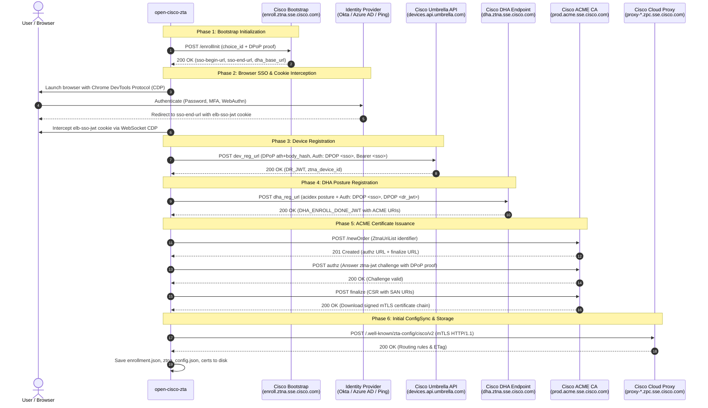

# Client Enrollment & Authentication Deep-Dive

This document details the complete end-to-end enrollment lifecycle, browser SSO authentication, RFC 9449 DPoP proofs, and custom ACME v2 certificate issuance in **open-cisco-zta**.

---

## 🔄 Enrollment Flow Overview

Client enrollment binds a local machine to a Cisco Secure Access tenant. It executes in six distinct phases:



---

## 🛠️ Step-by-Step Breakdown

### Phase 1: Bootstrap Initialization

1. The client instantiates an ephemeral ECDSA P-256 private key for RFC 9449 DPoP proofs.
2. It sends an HTTP `POST` request to `https://enroll.ztna.sse.cisco.com/enrollInit`:
   ```json
   {
     "type": "CiscoSecureAccess",
     "choice_id": "cisco-secure-access/default"
   }
   ```
3. The request includes a `Dpop` header signed over the POST URI.
4. The server returns:
   - `sso-begin-url`: Corporate IdP authentication entry URL.
   - `sso-end-url`: Redirect landing URL indicating successful login.
   - `dha_base_url`: Base URL for subsequent posture registration.

---

### Phase 2: Browser SSO Authentication & Cookie Capture

To eliminate manual token extraction:
1. `open-cisco-zta` detects installed Chromium browsers (Edge, Chrome, Brave).
2. It spawns the browser with an ephemeral profile directory and flags:
   - `--remote-debugging-port=0`
   - `--user-data-dir=<temp_dir>`
   - `--no-first-run --no-default-browser-check`
3. A local background task connects to the Chrome DevTools Protocol (CDP) WebSocket.
4. It enables network tracking (`Network.enable`) and listens for cookies targeting `sso-end-url`.
5. When the user completes authentication in their browser, the `elb-sso-jwt` cookie is captured automatically and the temporary browser process is terminated.
6. The JWT payload is parsed to extract user identity (`urn:cisco:sse:userid`), tenant organization ID (`urn:cisco:sse:orgid`), and API endpoints.

> [!NOTE]
> **Manual Fallback:** If browser automation fails or Python with `websockets` is not installed, the client prints the SSO URL and prompts the user to paste the `elb-sso-jwt` token manually. You can also pass it directly using `open-cisco-zta enroll --token <jwt>`.

---

### Phase 3: Device Registration

The client registers its hardware identity with Cisco Umbrella:
1. A persistent client hardware identifier is generated (stored in `machine_id`).
2. The client sends a `POST` request to `dev_reg_url`:
   ```json
   {
     "client_generated_id": "<machine_id>",
     "module_type_id": 57,
     "module_independent_device_id": "<machine_id>"
   }
   ```
3. **Composite Authorization Header:**
   ```http
   Authorization: DPOP <sso_jwt>, Bearer <sso_jwt>
   ```
4. **DPoP Proof:**
   The `Dpop` header contains an ES256 proof embedding both:
   - `ath`: Base64URL-encoded SHA-256 of the `sso_jwt`.
   - `body_hash`: Base64URL-encoded SHA-256 of the JSON request body.
5. The endpoint returns the Device Registration JWT (`dr_jwt`) and assigns the official `ztna_device_id`.

---

### Phase 4: DHA Posture Registration

1. The client constructs the device posture payload (`AcidexPayload`), honoring the `--os-profile` flag (`auto`, `linux`, `windows`).
2. An ephemeral EC P-256 key (`dha_enroll_pubkey`) is generated.
3. The client sends a `POST` request to `dha_reg_url`:
   ```json
   {
     "acidex": { ... },
     "dha_enroll_pubkey": "-----BEGIN PUBLIC KEY-----\n..."
   }
   ```
4. **Composite Authorization Header:**
   ```http
   Authorization: DPOP <sso_jwt>, DPOP <dr_jwt>
   ```
5. **Dual-Token DPoP Proof:**
   The `Dpop` proof embeds `elb_ath` (hash of `sso_jwt`), `dr_ath` (hash of `dr_jwt`), and `body_hash`.
6. The server responds with `DHA_ENROLL_DONE_JWT`. This JWT contains the authoritative ACME identity URIs and serves as the bearer token to satisfy the ACME challenge.

---

### Phase 5: ACME Certificate Issuance (RFC 8555 + Cisco Extensions)

1. The client generates an EC P-256 private key and Certificate Signing Request (CSR):
   - CommonName: `urn:cisco:sse:ztna:deviceid:<device_id>`
   - Subject Alternative Names (SANs): Encoded as `SanType::URI` for org ID, user ID, and device ID.
2. **Order Submission:**
   - Connects to Cisco ACME directory (`prod.acme.sse.cisco.com`).
   - Submits a new certificate order with a custom identifier type:
     - `type: "ZtnaUriList"`
     - `value`: Base64URL-encoded deterministically sorted JSON map of SAN URIs.
3. **Challenge Validation (`ztna-jwt`):**
   - Cisco's ACME server issues a custom challenge with `type == "ztna-jwt"`.
   - The client answers the challenge with `POST {}` accompanied by:
     - `Authorization: DPoP <dha_enroll_done_jwt>`
     - `Dpop: <proof>`
4. **Order Finalization:**
   - The client posts the DER-encoded CSR to the order finalize URL.
   - It polls until order status transitions to `valid`.
   - It downloads the intermediate CA-signed mTLS client certificate chain and saves it to `client_cert.pem`.

---

### Phase 6: Initial Synchronization & Persistence

1. Connects to `config_sync_url` over mTLS using HTTP/1.1.
2. Posts posture data to retrieve the initial routing policy (`ztna_config.json`) and caching ETag.
3. Persists all credentials, identifiers, and keys to `enrollment.json`.

---

## 🔒 Privilege & Safety Guidelines

### Why `enroll` Should Run Without `sudo`
- **Desktop Browser Session Isolation:** Running `sudo open-cisco-zta enroll` attempts to spawn Chrome/Edge inside the root user's desktop environment, which fails on modern Linux systems due to sandbox and X11/Wayland display permissions.
- **File Ownership:** Enrolling under root creates files owned by `root:root` in `/root/.config/open-cisco-zta`, preventing regular user tools or scripts from accessing them.
- **Safety Check:** `check_enroll_privileges()` detects root execution and safely aborts with an explanation.

### Headless Server Enrollment
If you are enrolling on a remote headless Linux server without a GUI:
```bash
sudo open-cisco-zta enroll --allow-root
```
You can then pass an SSO JWT token acquired on your workstation:
```bash
sudo open-cisco-zta enroll --allow-root --token "<JWT>"
```
